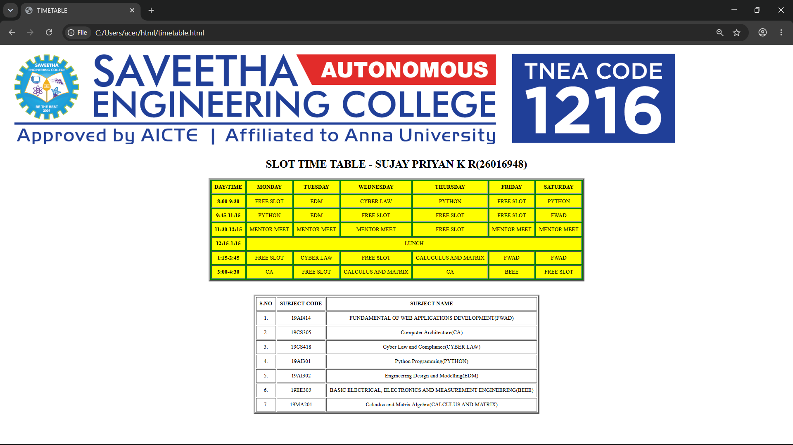

# Ex02 Time Table
## Date:21/11/2026

## AIM
To write a html webpage page to display your slot timetable.

## ALGORITHM
### STEP 1
Create a Django-admin Interface.

### STEP 2
Create an App inside the Django project.

### STEP 2
Create a static folder uder the created App and insert HTML code.

### STEP 3
Create a simple table using ```<table>``` tag in html with the relevant attributes.

### STEP 4
Add rows using ```<tr>``` tag.

### STEP 5
Add your course schedule using ```<td>``` tag.

### STEP 6
Execute the program using runserver command.

## PROGRAM
file.html
```
<html>
    <head>
        <title>TIMETABLE</title>
    </head>
    <body>
        
        <h1 align="center">SLOT TIME TABLE - SUJAY PRIYAN K R(26016948)</h1>
        <table border="5" cellpadding="8" cellspacing="4" align="center" bgcolor="green">
            <tr align="center" bgcolor="yellow">
                <th>DAY/TIME</th>
                <th>MONDAY</th>
                <th>TUESDAY</th>
                <th>WEDNESDAY</th>
                <th>THURSDAY</th>
                <th>FRIDAY</th>
                <th>SATURDAY</th>
            </tr>
            <tr align="center" bgcolor="yellow">
                <th>8:00-9:30</th>
                <td>FREE SLOT</td>
                <td>EDM</td>
                <td>CYBER LAW</td>
                <td>PYTHON</td>
                <td>FREE SLOT</td>
                <td>PYTHON</td>

            </tr>
            <TR align="center" bgcolor="yellow">
                <th>9:45-11:15</th>
                <td>PYTHON</td>
                <td>EDM</td>
                <TD>FREE SLOT</TD>
                <td>FREE SLOT</td>
                <TD>FREE SLOT</TD>
                <TD>FWAD</TD>
            </TR>
            <TR align="center" bgcolor="yellow">
                <TH>11:30-12:15</TH>
                <TD>MENTOR MEET</TD>
                <TD>MENTOR MEET</TD>
                <TD>MENTOR MEET</TD>
                <TD>FREE SLOT</TD>
                <TD>MENTOR MEET</TD>
                <TD>MENTOR MEET</TD>
            </TR>
            <TR align="center" bgcolor="yellow">
                <TH>12:15-1:15</TH>
                <TD colspan="6">LUNCH</TD>

            </TR>
            <tr align="center" bgcolor="yellow">
                <th>1:15-2:45</th>
                <td>FREE SLOT</td>
                <td>CYBER LAW</td>
                <td>FREE SLOT</td>
                <td>CALUCULUS AND MATRIX</td>
                <td>FWAD</td>
                <td>FWAD</td>
            </tr>
            <TR align="center" bgcolor="yellow">
                <th>3:00-4:30</th>
                <td>CA</td>
                <TD>FREE SLOT</TD>
                <TD>CALCULUS AND MATRIX</TD>
                <TD>CA</TD>
                <TD>BEEE</TD>
                <TD>FREE SLOT</TD>
            </TR>
        </table>
        <br>
        <br>
        <table  border="5" cellpadding="9" cellspacing="3" align="center" bgcolor="white">
            <tr align="center">
                <th>S.NO</th>
                <TH>SUBJECT CODE</TH>
                <TH>SUBJECT NAME</TH>
            </tr>
            <TR align="center">
                <TD> 1. </TD>
                <TD> 19AI414 </TD>
                <TD> FUNDAMENTAL OF WEB APPLICATIONS DEVELOPMENT(FWAD)</TD>
            </TR>
            <TR align="center">
                <TD> 2. </TD>
                <TD> 19CS305 </TD>
                <TD>  Computer Architecture(CA)</TD>
            </TR>
            <TR align="center">
                <TD> 3. </TD>
                <TD> 19CS418 </TD>
                <TD> Cyber Law and Compliance(CYBER LAW) </TD>
            </TR>
            <TR align="center">
                <TD> 4. </TD>
                <TD> 19AI301 </TD>
                <TD> Python Programming(PYTHON) </TD>
            </TR>
            <TR align="center">
                <TD> 5. </TD>
                <TD> 19AI302 </TD>
                <TD> Engineering Design and Modelling(EDM) </TD>
            </TR>
            <TR align="center">
                <TD> 6. </TD>
                <TD> 19EE305 </TD>
                <TD> BASIC ELECTRICAL, ELECTRONICS AND MEASUREMENT ENGINEERING(BEEE) </TD>
            </TR>
            <TR align="center">
                <TD> 7. </TD>
                <TD> 19MA201 </TD>
                <TD> Calculus and Matrix Algebra(CALCULUS AND MATRIX)</TD>
            </TR>
        </table>
    </body>
</html>
```


## OUTPUT


## RESULT
The program for creating slot timetable using basic HTML tags is executed successfully.
